<picture>
  <source media="(prefers-color-scheme: dark)" srcset="./.github/readme/assets/banner-dark.svg">
  
</picture>

  
  

<!-- STATS:START -->

<picture>
  <source media="(prefers-color-scheme: dark)" srcset="./.github/readme/assets/stats-dark.svg">
  
</picture>

<picture>
  <source media="(prefers-color-scheme: dark)" srcset="./.github/readme/assets/heatmap-dark.svg">
  
</picture>

<picture>
  <source media="(prefers-color-scheme: dark)" srcset="./.github/readme/assets/skills-dark.svg">
  
</picture>

## Recent AC

| | Problem | Difficulty | Pushed |
|:-:|---|:-:|:-:|
| ✅ | [1360. Number of Days Between Two Dates](https://leetcode.com/problems/number-of-days-between-two-dates/) | $\color{#00b8a3}{\textsf{Easy}}$ | Nov 11, 2026 |
| ✅ | [496. Next Greater Element I](https://leetcode.com/problems/next-greater-element-i/) | $\color{#00b8a3}{\textsf{Easy}}$ | Nov 11, 2026 |
| ✅ | [225. Implement Stack using Queues](https://leetcode.com/problems/implement-stack-using-queues/) | $\color{#00b8a3}{\textsf{Easy}}$ | Nov 11, 2026 |
| ✅ | [2390. Removing Stars From a String](https://leetcode.com/problems/removing-stars-from-a-string/) | $\color{#ffc01e}{\textsf{Medium}}$ | Nov 10, 2026 |
| ✅ | [1991. Find the Middle Index in Array](https://leetcode.com/problems/find-the-middle-index-in-array/) | $\color{#00b8a3}{\textsf{Easy}}$ | Nov 10, 2026 |

## Problem List

35 solved &nbsp;·&nbsp; 20 Easy &nbsp;·&nbsp; 13 Medium &nbsp;·&nbsp; 2 Hard

| Status | Title | Acceptance | Difficulty | Solution |
|:-:|---|:-:|:-:|:-:|
| ✅ | [1. Two Sum](https://leetcode.com/problems/two-sum/) | 58.1% | $\color{#00b8a3}{\textsf{Easy}}$ | [C++](./Problems/P1%20-%20Two%20Sum%20-%20Easy) |
| ✅ | [2. Add Two Numbers](https://leetcode.com/problems/add-two-numbers/) | 49.6% | $\color{#ffc01e}{\textsf{Medium}}$ | [C++](./Problems/P2%20-%20Add%20Two%20Numbers%20-%20Medium) |
| ✅ | [3. Longest Substring Without Repeating Characters](https://leetcode.com/problems/longest-substring-without-repeating-characters/) | 40.0% | $\color{#ffc01e}{\textsf{Medium}}$ | [C++](./Problems/P3%20-%20Longest%20Substring%20Without%20Repeating%20Characters%20-%20Medium) |
| ✅ | [13. Roman to Integer](https://leetcode.com/problems/roman-to-integer/) | 67.3% | $\color{#00b8a3}{\textsf{Easy}}$ | [C++](./Problems/P13%20-%20Roman%20to%20Integer%20-%20Easy) |
| ✅ | [14. Longest Common Prefix](https://leetcode.com/problems/longest-common-prefix/) | 48.6% | $\color{#00b8a3}{\textsf{Easy}}$ | [C++](./Problems/P14%20-%20Longest%20Common%20Prefix%20-%20Easy) |
| ✅ | [21. Merge Two Sorted Lists](https://leetcode.com/problems/merge-two-sorted-lists/) | 69.1% | $\color{#00b8a3}{\textsf{Easy}}$ | [C++](./Problems/P21%20-%20Merge%20Two%20Sorted%20Lists%20-%20Easy) |
| ✅ | [23. Merge k Sorted Lists](https://leetcode.com/problems/merge-k-sorted-lists/) | 60.8% | $\color{#ff375f}{\textsf{Hard}}$ | [C++](./Problems/P23%20-%20Merge%20k%20Sorted%20Lists%20-%20Hard) |
| ✅ | [38. Count and Say](https://leetcode.com/problems/count-and-say/) | 64.1% | $\color{#ffc01e}{\textsf{Medium}}$ | [C++](./Problems/P38%20-%20Count%20and%20Say%20-%20Medium) |
| ✅ | [48. Rotate Image](https://leetcode.com/problems/rotate-image/) | 80.9% | $\color{#ffc01e}{\textsf{Medium}}$ | [C++](./Problems/P48%20-%20Rotate%20Image%20-%20Medium) |
| ✅ | [101. Symmetric Tree](https://leetcode.com/problems/symmetric-tree/) | 62.3% | $\color{#00b8a3}{\textsf{Easy}}$ | [C++](./Problems/P101%20-%20Symmetric%20Tree%20-%20Easy) |
| ✅ | [107. Binary Tree Level Order Traversal II](https://leetcode.com/problems/binary-tree-level-order-traversal-ii/) | 69.4% | $\color{#ffc01e}{\textsf{Medium}}$ | [C++](./Problems/P107%20-%20Binary%20Tree%20Level%20Order%20Traversal%20II%20-%20Medium) |
| ✅ | [121. Best Time to Buy and Sell Stock](https://leetcode.com/problems/best-time-to-buy-and-sell-stock/) | 57.6% | $\color{#00b8a3}{\textsf{Easy}}$ | [C++](./Problems/P121%20-%20Best%20Time%20to%20Buy%20and%20Sell%20Stock%20-%20Easy) |
| ✅ | [125. Valid Palindrome](https://leetcode.com/problems/valid-palindrome/) | 54.6% | $\color{#00b8a3}{\textsf{Easy}}$ | [C++](./Problems/P125%20-%20Valid%20Palindrome%20-%20Easy) |
| ✅ | [141. Linked List Cycle](https://leetcode.com/problems/linked-list-cycle/) | 55.3% | $\color{#00b8a3}{\textsf{Easy}}$ | [C++](./Problems/P141%20-%20Linked%20List%20Cycle%20-%20Easy) |
| ✅ | [143. Reorder List](https://leetcode.com/problems/reorder-list/) | 66.6% | $\color{#ffc01e}{\textsf{Medium}}$ | [C++](./Problems/P143%20-%20Reorder%20List%20-%20Medium) |
| ✅ | [215. Kth Largest Element in an Array](https://leetcode.com/problems/kth-largest-element-in-an-array/) | 69.5% | $\color{#ffc01e}{\textsf{Medium}}$ | [C++](./Problems/P215%20-%20Kth%20Largest%20Element%20in%20an%20Array%20-%20Medium) |
| ✅ | [225. Implement Stack using Queues](https://leetcode.com/problems/implement-stack-using-queues/) | 70.5% | $\color{#00b8a3}{\textsf{Easy}}$ | [C++](./Problems/P225%20-%20Implement%20Stack%20using%20Queues%20-%20Easy) |
| ✅ | [231. Power of Two](https://leetcode.com/problems/power-of-two/) | 50.7% | $\color{#00b8a3}{\textsf{Easy}}$ | [C++](./Problems/P231%20-%20Power%20of%20Two%20-%20Easy) |
| ✅ | [232. Implement Queue using Stacks](https://leetcode.com/problems/implement-queue-using-stacks/) | 70.3% | $\color{#00b8a3}{\textsf{Easy}}$ | [C++](./Problems/P232%20-%20Implement%20Queue%20using%20Stacks%20-%20Easy) |
| ✅ | [326. Power of Three](https://leetcode.com/problems/power-of-three/) | 51.8% | $\color{#00b8a3}{\textsf{Easy}}$ | [C++](./Problems/P326%20-%20Power%20of%20Three%20-%20Easy) |
| ✅ | [496. Next Greater Element I](https://leetcode.com/problems/next-greater-element-i/) | 77.0% | $\color{#00b8a3}{\textsf{Easy}}$ | [C++](./Problems/P496%20-%20Next%20Greater%20Element%20I%20-%20Easy) |
| ✅ | [560. Subarray Sum Equals K](https://leetcode.com/problems/subarray-sum-equals-k/) | 48.4% | $\color{#ffc01e}{\textsf{Medium}}$ | [C++](./Problems/P560%20-%20Subarray%20Sum%20Equals%20K%20-%20Medium) |
| ✅ | [643. Maximum Average Subarray I](https://leetcode.com/problems/maximum-average-subarray-i/) | 49.5% | $\color{#00b8a3}{\textsf{Easy}}$ | [C++](./Problems/P643%20-%20Maximum%20Average%20Subarray%20I%20-%20Easy) |
| ✅ | [1360. Number of Days Between Two Dates](https://leetcode.com/problems/number-of-days-between-two-dates/) | 53.9% | $\color{#00b8a3}{\textsf{Easy}}$ | [C++](./Problems/P1360%20-%20Number%20of%20Days%20Between%20Two%20Dates%20-%20Easy) |
| ✅ | [1483. Kth Ancestor of a Tree Node](https://leetcode.com/problems/kth-ancestor-of-a-tree-node/) | 40.1% | $\color{#ff375f}{\textsf{Hard}}$ | [C++](./Problems/P1483%20-%20Kth%20Ancestor%20of%20a%20Tree%20Node%20-%20Hard) |
| ✅ | [1662. Check If Two String Arrays are Equivalent](https://leetcode.com/problems/check-if-two-string-arrays-are-equivalent/) | 86.3% | $\color{#00b8a3}{\textsf{Easy}}$ | [C++](./Problems/P1662%20-%20Check%20If%20Two%20String%20Arrays%20are%20Equivalent%20-%20Easy) |
| ✅ | [1991. Find the Middle Index in Array](https://leetcode.com/problems/find-the-middle-index-in-array/) | 70.9% | $\color{#00b8a3}{\textsf{Easy}}$ | [C++](./Problems/P1991%20-%20Find%20the%20Middle%20Index%20in%20Array%20-%20Easy) |
| ✅ | [2075. Decode the Slanted Ciphertext](https://leetcode.com/problems/decode-the-slanted-ciphertext/) | 67.7% | $\color{#ffc01e}{\textsf{Medium}}$ | [C++](./Problems/P2075%20-%20Decode%20the%20Slanted%20Ciphertext%20-%20Medium) |
| ✅ | [2279. Maximum Bags With Full Capacity of Rocks](https://leetcode.com/problems/maximum-bags-with-full-capacity-of-rocks/) | 68.4% | $\color{#ffc01e}{\textsf{Medium}}$ | [C++](./Problems/P2279%20-%20Maximum%20Bags%20With%20Full%20Capacity%20of%20Rocks%20-%20Medium) |
| ✅ | [2390. Removing Stars From a String](https://leetcode.com/problems/removing-stars-from-a-string/) | 80.1% | $\color{#ffc01e}{\textsf{Medium}}$ | [C++](./Problems/P2390%20-%20Removing%20Stars%20From%20a%20String%20-%20Medium) |
| ✅ | [2409. Count Days Spent Together](https://leetcode.com/problems/count-days-spent-together/) | 66.9% | $\color{#00b8a3}{\textsf{Easy}}$ | [C++](./Problems/P2409%20-%20Count%20Days%20Spent%20Together%20-%20Easy) |
| ✅ | [2778. Sum of Squares of Special Elements](https://leetcode.com/problems/sum-of-squares-of-special-elements/) | 87.0% | $\color{#00b8a3}{\textsf{Easy}}$ | [C++](./Problems/P2778%20-%20Sum%20of%20Squares%20of%20Special%20Elements%20-%20Easy) |
| ✅ | [3619. Count Islands With Total Value Divisible by K](https://leetcode.com/problems/count-islands-with-total-value-divisible-by-k/) | 58.3% | $\color{#ffc01e}{\textsf{Medium}}$ | [C++](./Problems/P3619%20-%20Count%20Islands%20With%20Total%20Value%20Divisible%20by%20K%20-%20Medium) |
| ✅ | [3882. Minimum XOR Path in a Grid](https://leetcode.com/problems/minimum-xor-path-in-a-grid/) | 56.8% | $\color{#ffc01e}{\textsf{Medium}}$ | [C++](./Problems/P3882%20-%20Minimum%20XOR%20Path%20in%20a%20Grid%20-%20Medium) |
| ✅ | [3963. Create Grid With Exactly One Path](https://leetcode.com/problems/create-grid-with-exactly-one-path/) | 77.3% | $\color{#00b8a3}{\textsf{Easy}}$ | [C++](./Problems/P3963%20-%20Create%20Grid%20With%20Exactly%20One%20Path%20-%20Easy) |

## Contests

| Contest | Solved | Pushed | Solutions |
|---|:-:|:-:|:-:|
| 🏆 Biweekly Contest 194 | 2 | Oct 26, 2026 | [View](./Contests/Biweekly%20Contest%20194) |

Contest problems are listed separately and are not counted in the totals above.
<!-- STATS:END -->

---

  

