<picture>
  <source media="(prefers-color-scheme: dark)" srcset="./.github/readme/assets/banner-dark.svg">
  
</picture>

  
  

<!-- STATS:START -->

<picture>
  <source media="(prefers-color-scheme: dark)" srcset="./.github/readme/assets/stats-dark.svg">
  
</picture>

<picture>
  <source media="(prefers-color-scheme: dark)" srcset="./.github/readme/assets/heatmap-dark.svg">
  
</picture>

<picture>
  <source media="(prefers-color-scheme: dark)" srcset="./.github/readme/assets/skills-dark.svg">
  
</picture>

## Recent AC

| | Problem | Difficulty | Pushed |
|:-:|---|:-:|:-:|
| ✅ | [2778. Sum of Squares of Special Elements](https://leetcode.com/problems/sum-of-squares-of-special-elements/) | $\color{#00b8a3}{\textsf{Easy}}$ | Oct 29, 2026 |
| ✅ | [560. Subarray Sum Equals K](https://leetcode.com/problems/subarray-sum-equals-k/) | $\color{#ffc01e}{\textsf{Medium}}$ | Oct 29, 2026 |
| ✅ | [3882. Minimum XOR Path in a Grid](https://leetcode.com/problems/minimum-xor-path-in-a-grid/) | $\color{#ffc01e}{\textsf{Medium}}$ | Oct 28, 2026 |
| ✅ | [3963. Create Grid With Exactly One Path](https://leetcode.com/problems/create-grid-with-exactly-one-path/) | $\color{#00b8a3}{\textsf{Easy}}$ | Oct 27, 2026 |
| ✅ | [2279. Maximum Bags With Full Capacity of Rocks](https://leetcode.com/problems/maximum-bags-with-full-capacity-of-rocks/) | $\color{#ffc01e}{\textsf{Medium}}$ | Oct 27, 2026 |

## Problem List

17 solved &nbsp;·&nbsp; 7 Easy &nbsp;·&nbsp; 9 Medium &nbsp;·&nbsp; 1 Hard

| Status | Title | Acceptance | Difficulty | Solution |
|:-:|---|:-:|:-:|:-:|
| ✅ | [1. Two Sum](https://leetcode.com/problems/two-sum/) | 58.1% | $\color{#00b8a3}{\textsf{Easy}}$ | [C++](./Problems/P1%20-%20Two%20Sum%20-%20Easy) |
| ✅ | [2. Add Two Numbers](https://leetcode.com/problems/add-two-numbers/) | 49.6% | $\color{#ffc01e}{\textsf{Medium}}$ | [C++](./Problems/P2%20-%20Add%20Two%20Numbers%20-%20Medium) |
| ✅ | [3. Longest Substring Without Repeating Characters](https://leetcode.com/problems/longest-substring-without-repeating-characters/) | 40.0% | $\color{#ffc01e}{\textsf{Medium}}$ | [C++](./Problems/P3%20-%20Longest%20Substring%20Without%20Repeating%20Characters%20-%20Medium) |
| ✅ | [13. Roman to Integer](https://leetcode.com/problems/roman-to-integer/) | 67.3% | $\color{#00b8a3}{\textsf{Easy}}$ | [C++](./Problems/P13%20-%20Roman%20to%20Integer%20-%20Easy) |
| ✅ | [14. Longest Common Prefix](https://leetcode.com/problems/longest-common-prefix/) | 48.6% | $\color{#00b8a3}{\textsf{Easy}}$ | [C++](./Problems/P14%20-%20Longest%20Common%20Prefix%20-%20Easy) |
| ✅ | [23. Merge k Sorted Lists](https://leetcode.com/problems/merge-k-sorted-lists/) | 60.8% | $\color{#ff375f}{\textsf{Hard}}$ | [C++](./Problems/P23%20-%20Merge%20k%20Sorted%20Lists%20-%20Hard) |
| ✅ | [38. Count and Say](https://leetcode.com/problems/count-and-say/) | 64.1% | $\color{#ffc01e}{\textsf{Medium}}$ | [C++](./Problems/P38%20-%20Count%20and%20Say%20-%20Medium) |
| ✅ | [48. Rotate Image](https://leetcode.com/problems/rotate-image/) | 80.9% | $\color{#ffc01e}{\textsf{Medium}}$ | [C++](./Problems/P48%20-%20Rotate%20Image%20-%20Medium) |
| ✅ | [326. Power of Three](https://leetcode.com/problems/power-of-three/) | 51.8% | $\color{#00b8a3}{\textsf{Easy}}$ | [C++](./Problems/P326%20-%20Power%20of%20Three%20-%20Easy) |
| ✅ | [560. Subarray Sum Equals K](https://leetcode.com/problems/subarray-sum-equals-k/) | 48.4% | $\color{#ffc01e}{\textsf{Medium}}$ | [C++](./Problems/P560%20-%20Subarray%20Sum%20Equals%20K%20-%20Medium) |
| ✅ | [2075. Decode the Slanted Ciphertext](https://leetcode.com/problems/decode-the-slanted-ciphertext/) | 67.7% | $\color{#ffc01e}{\textsf{Medium}}$ | [C++](./Problems/P2075%20-%20Decode%20the%20Slanted%20Ciphertext%20-%20Medium) |
| ✅ | [2279. Maximum Bags With Full Capacity of Rocks](https://leetcode.com/problems/maximum-bags-with-full-capacity-of-rocks/) | 68.4% | $\color{#ffc01e}{\textsf{Medium}}$ | [C++](./Problems/P2279%20-%20Maximum%20Bags%20With%20Full%20Capacity%20of%20Rocks%20-%20Medium) |
| ✅ | [2409. Count Days Spent Together](https://leetcode.com/problems/count-days-spent-together/) | 66.9% | $\color{#00b8a3}{\textsf{Easy}}$ | [C++](./Problems/P2409%20-%20Count%20Days%20Spent%20Together%20-%20Easy) |
| ✅ | [2778. Sum of Squares of Special Elements](https://leetcode.com/problems/sum-of-squares-of-special-elements/) | 87.0% | $\color{#00b8a3}{\textsf{Easy}}$ | [C++](./Problems/P2778%20-%20Sum%20of%20Squares%20of%20Special%20Elements%20-%20Easy) |
| ✅ | [3619. Count Islands With Total Value Divisible by K](https://leetcode.com/problems/count-islands-with-total-value-divisible-by-k/) | 58.3% | $\color{#ffc01e}{\textsf{Medium}}$ | [C++](./Problems/P3619%20-%20Count%20Islands%20With%20Total%20Value%20Divisible%20by%20K%20-%20Medium) |
| ✅ | [3882. Minimum XOR Path in a Grid](https://leetcode.com/problems/minimum-xor-path-in-a-grid/) | 56.8% | $\color{#ffc01e}{\textsf{Medium}}$ | [C++](./Problems/P3882%20-%20Minimum%20XOR%20Path%20in%20a%20Grid%20-%20Medium) |
| ✅ | [3963. Create Grid With Exactly One Path](https://leetcode.com/problems/create-grid-with-exactly-one-path/) | 77.3% | $\color{#00b8a3}{\textsf{Easy}}$ | [C++](./Problems/P3963%20-%20Create%20Grid%20With%20Exactly%20One%20Path%20-%20Easy) |

## Contests

| Contest | Solved | Pushed | Solutions |
|---|:-:|:-:|:-:|
| 🏆 Biweekly Contest 194 | 2 | Oct 26, 2026 | [View](./Contests/Biweekly%20Contest%20194) |

Contest problems are listed separately and are not counted in the totals above.
<!-- STATS:END -->

---

  

